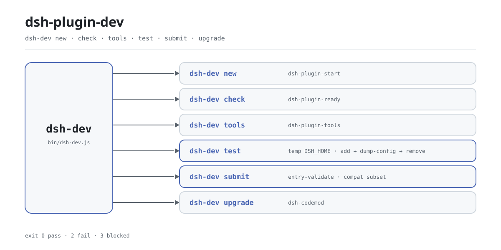

<div align="center">

<picture>
  <source media="(prefers-color-scheme: dark)" srcset="docs/assets/dsh-plugin-dev-flow-dark.svg">
  
</picture>

# dsh-plugin-dev

**One command covers the whole DSH plugin loop — scaffold, preflight, smoke test, pre-release check.**

A thin dispatcher for DeepSeek Harness plugin authors: six actions point at tools the family already ships, and installing it adds exactly one executable, `dsh-dev` — no config file, no daemon, exits when done.

[Install](#three-step-setup) · [Configuration](#configuration) · [FAQ](#faq) · [简体中文](README.md) · [English](README.en.md) · [Español](README.es.md) · [Português](README.pt.md) · [हिन्दी](README.hi.md)

[](LICENSE)
[](https://www.npmjs.com/package/dsh-plugin-dev)
[](https://github.com/PerryLink/dsh-plugin-dev/actions/workflows/test.yml)
[](#three-step-setup)

[](https://github.com/PerryLink/dsh-plugin-dev/stargazers)
[](https://www.npmjs.com/package/dsh-plugin-dev)
[](https://gitee.com/perrylink/dsh-plugin-dev)

```sh
npm i -g dsh-plugin-dev    # provides the dsh-dev command
npx dsh-plugin-dev --help  # or run it without installing
```

</div>

<sub>Community tool, not affiliated with DeepSeek. Canonical repository: <https://github.com/PerryLink/dsh-plugin-dev> (Gitee is a mirror).</sub>

## What it is

`dsh-dev` is the single entry point for the DSH plugin development loop: scaffold, preflight, toolchain, isolated smoke test, pre-release check, and upgrade all share one command. It barely implements any of that itself — `new` delegates to `dsh-plugin-start`, `check` to `dsh-plugin-ready`, `tools` to `dsh-plugin-tools`, and `upgrade` only locates and calls `dsh-codemod`; what this repo actually orchestrates is `test` and `submit`. The three sub-tools ship as ordinary npm dependencies, so one global install gives you all six actions.

The package is called `dsh-plugin-dev` and the command is called `dsh-dev` on purpose: `dsh-primer` already owns a `dsh-plugin-dev` executable, so a shorter name lets both coexist. And because it is not a DSH plugin — it mounts no profile, needs no `cordis.patch.yml`, and never lives inside the host process — it is just a plain Node CLI that exits when done.

## Three-step setup

1. **Install** (Node `>=24.9.0`):

   ```sh
   npm i -g dsh-plugin-dev      # global install, then use dsh-dev
   npx dsh-plugin-dev --version # or run it without installing
   ```

   There is no build step and no profile to pick — it registers no host extension.

2. **Scaffold and preflight**:

   ```sh
   dsh-dev new my-plugin --dir ./my-plugin
   cd my-plugin
   dsh-dev check . --strict
   ```

   `new` is an alias of `dsh-plugin-start`; `--client` also scaffolds the browser half. `check` is an alias of `dsh-plugin-ready`; `--strict` treats warnings as failures.

3. **Smoke-test in isolation**:

   ```sh
   dsh-dev test . --boot
   ```

   ```text
   dsh-dev test: pass
   target: /path/to/my-plugin
     PASS dsh plugin --profile test add /path/to/my-plugin
     PASS dsh --profile test --dump-config
     PASS dsh --profile test --no-open --port 0
     PASS dsh plugin --profile test remove my-plugin
   not claimed: full UI/boot, C3 certification, security audit
   ```

   `test` points `DSH_HOME` at a fresh temp directory, runs install, config dump, and remove there, then deletes the whole directory; `--boot` only grabs one startup URL, and no URL means `blocked`, not a broken plugin.

   *Observed from `src/dev.js:41-59`; `src/host-test.js:28-118`*

**Uninstall**: `npm uninstall -g dsh-plugin-dev`.

## Core capabilities

Six actions, one entry point. `dsh-dev` only normalizes arguments and hands them over; the real checking lives in the sub-tools. `--help` and `--version` are built in, and an unknown command prints usage and returns 1.

- **`new` — start a plugin.** Delegates to `dsh-plugin-start`: `--dir` picks the target directory, `--client` scaffolds the browser half too.
- **`check` — preflight before you submit.** Delegates to `dsh-plugin-ready`: `--json` gives machine-readable output, `--strict` upgrades warnings to failures.
- **`tools` — toolchain management.** Delegates to `dsh-plugin-tools`, with `list`, `doctor`, `install`, and `update` subcommands; it prints the exact `npm install -g` command instead of installing anything.
- **`test` — isolated smoke test.** Runs install, config dump, and remove inside a temp `DSH_HOME`; `--boot` also starts one `--port 0` probe and captures the URL. Exit code `0` passes, `2` fails, `3` is blocked.
- **`submit` — pre-release check.** Prefers a `dsh-plugin-spec` (the legacy `dsh-standards` name also works) `entry-validate` checkout, falls back to the same checker vendored in this package, then to a compat subset. C3 is FLOW-only: with no host evidence it is `not-applicable`, and no score, ranking, or certification is produced.
- **`upgrade` — codemod hand-off.** Probes for `dsh-codemod`: hands over when present, prints the install command and returns 3 when missing.

```text
dsh-dev new     ──▶ dsh-plugin-start
dsh-dev check   ──▶ dsh-plugin-ready
dsh-dev tools   ──▶ dsh-plugin-tools
dsh-dev test    ──▶ temp DSH_HOME · add → dump-config → remove
dsh-dev submit  ──▶ entry-validate · compat subset
dsh-dev upgrade ──▶ dsh-codemod
```

### Command overview

| Command | Alias | Key flags | Hands over to |
|---|---|---|---|
| `dsh-dev new` | `start` | `--dir` `--client` | `dsh-plugin-start` |
| `dsh-dev check` | `ready` | `--json` `--strict` | `dsh-plugin-ready` |
| `dsh-dev tools` | — | `list` `doctor` `install` `update` | `dsh-plugin-tools` |
| `dsh-dev test` | — | `--json` `--boot` | this repo: temp `DSH_HOME` |
| `dsh-dev submit` | — | `--standards` `--meta` `--host-evidence` `--host-version` `--json` | `entry-validate` or the vendored checker |
| `dsh-dev upgrade` | — | — | `dsh-codemod` |

## Configuration

`dsh-dev` has no config file and no global state to write: every switch is a command-line flag, and most are passed through to the downstream tool unchanged. The only environment variable it reads is `DSH_STANDARDS_DIR` — `submit` checks it first when auto-detecting a checker checkout.

The most common flags:

| Flag | Commands | Meaning |
|---|---|---|
| `--help` / `-h` | all | Print full usage; no arguments at all is equivalent |
| `--version` / `-v` | all | Print the version |
| `--dir <dir>` | `new` | Target directory, derived from the plugin name by default |
| `--json` | `check` `test` `submit` | Machine-readable JSON output |
| `--strict` | `check` | Treat warnings as failures (passed through) |
| `--boot` | `test` | Also probe one host startup URL |
| `--meta <file>` | `submit` | Repo metadata: `repo`, `topics`, `archived` |

<details>
<summary>Full flag table (11 flags)</summary>

| Flag | Commands | Default | Meaning |
|---|---|---|---|
| `--help` / `-h` | all | — | Print usage and exit 0 |
| `--version` / `-v` | all | — | Print the version and exit 0 |
| `--dir <dir>` | `new` | plugin name | Target directory |
| `--client` | `new` | off | Scaffold the browser half too (passed through) |
| `--json` | `check` `test` `submit` | off | Machine-readable JSON output |
| `--strict` | `check` | off | Treat warnings as failures (passed through) |
| `--boot` | `test` | off | Also run `dsh --profile test --no-open --port 0` and capture the URL |
| `--standards <checkout>` | `submit` | auto-detect | Explicit `dsh-plugin-spec` or `dsh-standards` checkout |
| `--meta <file>` | `submit` | none | Repo metadata (`repo` / `topics` / `archived`) |
| `--host-evidence <file>` | `submit` | none | Host evidence; `dsh-evidence/1` is converted automatically |
| `--host-version <ver>` | `submit` | none | Host version passed through to C4 |

</details>

### Exit codes

| Code | Meaning | Where |
|---|---|---|
| `0` | Passed, or finished normally | every command |
| `1` | Unknown command or bad arguments | `dsh-dev`, a failed `upgrade` hand-off |
| `2` | Check failed | `test`, `submit` |
| `3` | Blocked or incomplete | `test` (missing environment), `submit` (incomplete), `upgrade` (no `dsh-codemod`) |

## FAQ

<details>
<summary>How does it relate to the three sub-tools?</summary>

It is a thin dispatcher over the implementation packages. `dsh-plugin-start`, `dsh-plugin-ready`, and `dsh-plugin-tools` are ordinary npm dependencies of `dsh-plugin-dev`, installed with it in one go — you never install them separately. `dsh-dev` only hands arguments to their entry points. Calling the sub-tools directly still works; you just have to remember three commands instead of one.

</details>

<details>
<summary>Does `test` touch my real ~/.dsh?</summary>

No. `test` creates a temp directory with `mkdtemp` and points `DSH_HOME` at it, so install, config dump, and remove all happen there. If the resolved path ever equals the real `~/.dsh`, it refuses to run. Cleanup sits in a `finally` block, so the temp directory is always deleted.

</details>

<details>
<summary>What is the difference between `blocked` and `fail`?</summary>

`blocked` means the environment does not meet a precondition — no `package.json` in the target directory, or no `dsh` / `pnpm` on `PATH` — and it is not a pass; the exit code is `3`. `fail` means a command actually failed; the exit code is `2`. Neither is green.

</details>

<details>
<summary>Does `submit` score or certify my plugin?</summary>

No. `submit` only checks pre-release consistency: it prefers `entry-validate`, then the vendored checker, then a compat subset, and its output states `not a certification`. C3 is FLOW-only, recorded as `not-applicable` when there is no host evidence, and never counted as a failure. There is no score, ranking, or official endorsement.

</details>

<details>
<summary>Do I need DSH installed to use it?</summary>

Not for the static commands: `new`, `check`, `tools`, `submit`, and `upgrade` all run locally and never start a host. Only `test` calls the `dsh` and `pnpm` on `PATH` (and `--boot` actually launches `dsh` once); missing them means `blocked`. The tool itself only requires Node `>=24.9.0`.

</details>

## Known limitations

- **Dispatch only, no implementation.** Scaffolding, static checks, and toolchain logic live in the sub-tools, so behavior follows their versions (currently pinned to `dsh-plugin-start@0.2.1`, `dsh-plugin-ready@0.2.2`, `dsh-plugin-tools@0.2.2`).
- **`test` is not a full UI/boot test.** It validates install, config dump, and remove only; `--boot` still grabs a single startup URL and records `blocked` when there is none. The output says `not claimed: full UI/boot` verbatim.
- **`submit` does not certify.** Without a standards checkout it uses the vendored checker or the compat subset and can reach at most `pass-with-warnings`; C3 without host evidence is `not-applicable`; no score, ranking, or certification is produced.
- **`upgrade` does not bundle the codemod.** It only probes for and calls `dsh-codemod`, returning 3 with install guidance when the command is missing.
- **External commands are required.** `dsh`, `pnpm`, and `dsh-codemod` must be on `PATH`; probing uses `where` on Windows and `which` elsewhere.
- **The Node version is a hard floor.** `>=24.9.0`; older versions cannot install or run it.

## Development

```sh
npm install
npm test                          # node --test, 10 cases
node bin/dsh-dev.js --help        # run from source
npm pack                          # build the published tarball
```

Layout:

| Path | Purpose |
|---|---|
| `bin/dsh-dev.js` | Executable entry: calls `main` and sets the exit code |
| `src/dev.js` | Command dispatch, usage text, `test`/`submit` argument parsing |
| `src/host-test.js` | The isolated `test` implementation |
| `src/submit.js` | Checker detection and compat subset for `submit` |
| `src/evidence.js` | `dsh-evidence/1` generation and conversion |
| `src/vendor/` | The vendored `entry-validate` checker |
| `test/` | `node --test` cases |
| `scripts/gen-readme-assets.py` | Generates both hero SVGs (Pillow + CJK font probe) |

Images are generated programmatically and can be regenerated:

```sh
python scripts/gen-readme-assets.py   # writes docs/assets/dsh-plugin-dev-flow-{light,dark}.svg
```

## Family & credits

This project is part of the PerryLink DSH plugin toolchain (all Apache-2.0): `dsh-plugin-start` handles scaffolding, `dsh-plugin-ready` handles preflight, `dsh-plugin-tools` handles the toolchain, and `dsh-dev` folds them into one entry point. If it saves you a few keystrokes, **give it a star** — it unlocks nothing, but it helps the next plugin author find it.

## License

[LICENSE](LICENSE) (Apache License 2.0) © 2026 dsh-plugin-dev contributors

<p align="center"><sub>Apache-2.0 · Community tool, not affiliated with DeepSeek.</sub></p>
