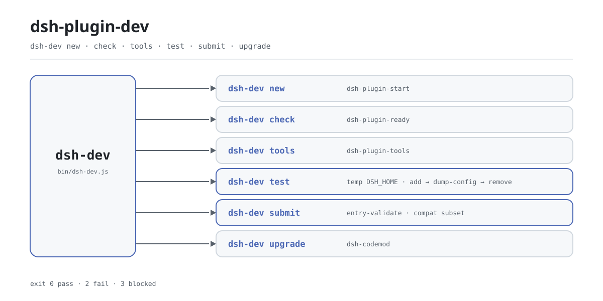

<div align="center">

<picture>
  <source media="(prefers-color-scheme: dark)" srcset="docs/assets/dsh-plugin-dev-flow-dark.svg">
  
</picture>

# dsh-plugin-dev

**Un solo comando cubre todo el ciclo del plugin DSH: andamiaje, preflight, prueba de humo y revisión previa a la publicación.**

Un despachador delgado para autores de plugins de DeepSeek Harness: seis acciones apuntan a herramientas que la familia ya publica, e instalarlo añade exactamente un ejecutable, `dsh-dev` — sin archivo de configuración, sin demonio, y sale al terminar.

[Instalación](#instalación-en-tres-pasos) · [Configuración](#configuración) · [FAQ](#faq) · [简体中文](README.md) · [English](README.en.md) · [Español](README.es.md) · [Português](README.pt.md) · [हिन्दी](README.hi.md)

[](LICENSE)
[](https://www.npmjs.com/package/dsh-plugin-dev)
[](https://github.com/PerryLink/dsh-plugin-dev/actions/workflows/test.yml)
[](#instalación-en-tres-pasos)

[](https://github.com/PerryLink/dsh-plugin-dev/stargazers)
[](https://www.npmjs.com/package/dsh-plugin-dev)
[](https://gitee.com/perrylink/dsh-plugin-dev)

```sh
npm i -g dsh-plugin-dev    # instala el comando dsh-dev
npx dsh-plugin-dev --help  # o pruébalo sin instalar
```

</div>

<sub>Herramienta comunitaria, sin afiliación con DeepSeek. Repositorio canónico: <https://github.com/PerryLink/dsh-plugin-dev> (Gitee es un espejo).</sub>

## Qué es

`dsh-dev` es el punto de entrada único del ciclo de desarrollo de plugins DSH: andamiaje, preflight, cadena de herramientas, prueba de humo aislada, revisión previa a la publicación y actualización comparten un solo comando. Apenas implementa nada por sí mismo: `new` delega en `dsh-plugin-start`, `check` en `dsh-plugin-ready`, `tools` en `dsh-plugin-tools`, y `upgrade` solo localiza y llama a `dsh-codemod`; lo que este repositorio orquesta de verdad es `test` y `submit`. Las tres subherramientas llegan como dependencias npm normales, así que una instalación global te da las seis acciones.

El paquete se llama `dsh-plugin-dev` y el comando se llama `dsh-dev` a propósito: `dsh-primer` ya ocupa un ejecutable `dsh-plugin-dev`, y un nombre más corto permite que ambos convivan. Y como no es un plugin DSH — no monta ningún profile, no necesita `cordis.patch.yml` y no vive dentro del proceso anfitrión — es simplemente una CLI de Node que termina al acabar.

## Instalación en tres pasos

1. **Instala** (Node `>=24.9.0`):

   ```sh
   npm i -g dsh-plugin-dev      # instalación global; luego usa dsh-dev
   npx dsh-plugin-dev --version # o ejecútalo sin instalar
   ```

   No hay paso de compilación ni profile que elegir: no registra ninguna extensión del anfitrión.

2. **Crea el andamiaje y pasa el preflight**:

   ```sh
   dsh-dev new my-plugin --dir ./my-plugin
   cd my-plugin
   dsh-dev check . --strict
   ```

   `new` es un alias de `dsh-plugin-start`; `--client` también genera la mitad de navegador. `check` es un alias de `dsh-plugin-ready`; `--strict` trata los avisos como fallos.

3. **Prueba de humo en aislamiento**:

   ```sh
   dsh-dev test . --boot
   ```

   ```text
   dsh-dev test: pass
   target: /path/to/my-plugin
     PASS dsh plugin --profile test add /path/to/my-plugin
     PASS dsh --profile test --dump-config
     PASS dsh --profile test --no-open --port 0
     PASS dsh plugin --profile test remove my-plugin
   not claimed: full UI/boot, C3 certification, security audit
   ```

   `test` apunta `DSH_HOME` a un directorio temporal nuevo, ejecuta allí instalación, volcado de configuración y desinstalación, y luego borra todo el directorio; `--boot` solo captura una URL de arranque, y no obtenerla significa `blocked`, no un plugin roto.

   *Observed from `src/dev.js:41-59`; `src/host-test.js:28-118`*

**Desinstalación**: `npm uninstall -g dsh-plugin-dev`.

## Capacidades principales

Seis acciones, un solo punto de entrada. `dsh-dev` solo normaliza argumentos y los entrega; la comprobación real vive en las subherramientas. `--help` y `--version` vienen integrados, y un comando desconocido imprime el uso y devuelve 1.

- **`new` — inicia un plugin.** Delega en `dsh-plugin-start`: `--dir` elige el directorio de destino y `--client` genera también la mitad de navegador.
- **`check` — preflight antes de enviar.** Delega en `dsh-plugin-ready`: `--json` da salida legible por máquina y `--strict` convierte los avisos en fallos.
- **`tools` — gestión de la cadena de herramientas.** Delega en `dsh-plugin-tools`, con los subcomandos `list`, `doctor`, `install` y `update`; imprime el comando exacto `npm install -g` en lugar de instalar nada.
- **`test` — prueba de humo aislada.** Ejecuta instalación, volcado de configuración y desinstalación dentro de un `DSH_HOME` temporal; `--boot` además arranca una sonda `--port 0` y captura la URL. Código de salida `0` aprueba, `2` falla, `3` está bloqueado.
- **`submit` — revisión previa a la publicación.** Prefiere un checkout `entry-validate` de `dsh-plugin-spec` (el nombre heredado `dsh-standards` también vale), si no usa el mismo comprobador empaquetado en este paquete y, como último recurso, un subconjunto compatible. C3 es solo FLOW: sin evidencia del anfitrión es `not-applicable`, y no se produce puntuación, ranking ni certificación.
- **`upgrade` — traspaso al codemod.** Sondea `dsh-codemod`: si existe le pasa el control, y si falta imprime la instalación y devuelve 3.

```text
dsh-dev new     ──▶ dsh-plugin-start
dsh-dev check   ──▶ dsh-plugin-ready
dsh-dev tools   ──▶ dsh-plugin-tools
dsh-dev test    ──▶ temp DSH_HOME · add → dump-config → remove
dsh-dev submit  ──▶ entry-validate · compat subset
dsh-dev upgrade ──▶ dsh-codemod
```

### Resumen de comandos

| Comando | Alias | Opciones clave | Delega en |
|---|---|---|---|
| `dsh-dev new` | `start` | `--dir` `--client` | `dsh-plugin-start` |
| `dsh-dev check` | `ready` | `--json` `--strict` | `dsh-plugin-ready` |
| `dsh-dev tools` | — | `list` `doctor` `install` `update` | `dsh-plugin-tools` |
| `dsh-dev test` | — | `--json` `--boot` | este repo: `DSH_HOME` temporal |
| `dsh-dev submit` | — | `--standards` `--meta` `--host-evidence` `--host-version` `--json` | `entry-validate` o el comprobador empaquetado |
| `dsh-dev upgrade` | — | — | `dsh-codemod` |

## Configuración

`dsh-dev` no tiene archivo de configuración ni estado global que escribir: todos los interruptores son opciones de línea de comandos y la mayoría se pasan tal cual a la herramienta de destino. La única variable de entorno que lee es `DSH_STANDARDS_DIR`: `submit` la consulta primero al detectar un checkout del comprobador.

Opciones más usadas:

| Opción | Comandos | Significado |
|---|---|---|
| `--help` / `-h` | todos | Imprime el uso completo; sin argumentos equivale a esto |
| `--version` / `-v` | todos | Imprime la versión |
| `--dir <dir>` | `new` | Directorio de destino; por defecto, el nombre del plugin |
| `--json` | `check` `test` `submit` | Salida JSON legible por máquina |
| `--strict` | `check` | Trata los avisos como fallos (se pasa tal cual) |
| `--boot` | `test` | Además sondea una URL de arranque del anfitrión |
| `--meta <file>` | `submit` | Metadatos del repo: `repo`, `topics`, `archived` |

<details>
<summary>Tabla completa de opciones (11)</summary>

| Opción | Comandos | Por defecto | Significado |
|---|---|---|---|
| `--help` / `-h` | todos | — | Imprime el uso y sale con 0 |
| `--version` / `-v` | todos | — | Imprime la versión y sale con 0 |
| `--dir <dir>` | `new` | nombre del plugin | Directorio de destino |
| `--client` | `new` | no | Genera también la mitad de navegador (se pasa tal cual) |
| `--json` | `check` `test` `submit` | no | Salida JSON legible por máquina |
| `--strict` | `check` | no | Avisos como fallos (se pasa tal cual) |
| `--boot` | `test` | no | Además ejecuta `dsh --profile test --no-open --port 0` y captura la URL |
| `--standards <checkout>` | `submit` | autodetección | Checkout explícito de `dsh-plugin-spec` o `dsh-standards` |
| `--meta <file>` | `submit` | ninguno | Metadatos del repo (`repo` / `topics` / `archived`) |
| `--host-evidence <file>` | `submit` | ninguno | Evidencia del anfitrión; `dsh-evidence/1` se convierte solo |
| `--host-version <ver>` | `submit` | ninguno | Versión del anfitrión que se pasa a C4 |

</details>

### Códigos de salida

| Código | Significado | Dónde |
|---|---|---|
| `0` | Aprobado o finalización normal | todos los comandos |
| `1` | Comando desconocido o argumentos inválidos | `dsh-dev`, traspaso fallido de `upgrade` |
| `2` | La comprobación falló | `test`, `submit` |
| `3` | Bloqueado o incompleto | `test` (entorno incompleto), `submit` (incomplete), `upgrade` (sin `dsh-codemod`) |

## FAQ

<details>
<summary>¿Cómo se relaciona con las tres subherramientas?</summary>

Es un despachador delgado sobre los paquetes de implementación. `dsh-plugin-start`, `dsh-plugin-ready` y `dsh-plugin-tools` son dependencias npm normales de `dsh-plugin-dev` y se instalan con él de una vez: nunca hace falta instalarlas por separado. `dsh-dev` solo pasa argumentos a sus puntos de entrada. Llamar a las subherramientas directamente también funciona; solo hay que recordar tres comandos en lugar de uno.

</details>

<details>
<summary>¿`test` toca mi ~/.dsh real?</summary>

No. `test` crea un directorio temporal con `mkdtemp` y apunta `DSH_HOME` allí, de modo que la instalación, el volcado de configuración y la desinstalación ocurren dentro. Si la ruta resuelta coincidiera con el `~/.dsh` real, se niega a ejecutarse. La limpieza está en un bloque `finally`, así que el directorio temporal siempre se borra.

</details>

<details>
<summary>¿Cuál es la diferencia entre `blocked` y `fail`?</summary>

`blocked` significa que el entorno no cumple una precondición —no hay `package.json` en el directorio de destino, o no hay `dsh` / `pnpm` en `PATH`— y no es un aprobado; el código de salida es `3`. `fail` significa que un comando falló de verdad; el código de salida es `2`. Ninguno de los dos está en verde.

</details>

<details>
<summary>¿`submit` puntúa o certifica mi plugin?</summary>

No. `submit` solo comprueba la coherencia previa a la publicación: prefiere `entry-validate`, luego el comprobador empaquetado y luego un subconjunto compatible, y su salida dice `not a certification`. C3 es solo FLOW, se registra como `not-applicable` cuando no hay evidencia del anfitrión y nunca cuenta como fallo. No hay puntuación, ranking ni respaldo oficial.

</details>

<details>
<summary>¿Necesito DSH instalado para usarlo?</summary>

No para los comandos estáticos: `new`, `check`, `tools`, `submit` y `upgrade` se ejecutan en local y nunca arrancan un anfitrión. Solo `test` llama al `dsh` y al `pnpm` del `PATH` (y `--boot` lanza `dsh` una vez de verdad); si faltan, el resultado es `blocked`. La herramienta en sí solo exige Node `>=24.9.0`.

</details>

## Limitaciones conocidas

- **Solo despacha, no implementa.** El andamiaje, las comprobaciones estáticas y la lógica de la cadena de herramientas viven en las subherramientas, así que el comportamiento sigue sus versiones (ahora fijadas a `dsh-plugin-start@0.2.1`, `dsh-plugin-ready@0.2.2`, `dsh-plugin-tools@0.2.2`).
- **`test` no es una prueba completa de UI/arranque.** Solo valida instalación, volcado de configuración y desinstalación; `--boot` sigue capturando una única URL de arranque y registra `blocked` cuando no la hay. La salida dice literalmente `not claimed: full UI/boot`.
- **`submit` no certifica.** Sin checkout de estándares usa el comprobador empaquetado o el subconjunto compatible y llega como máximo a `pass-with-warnings`; C3 sin evidencia del anfitrión es `not-applicable`; no se produce puntuación, ranking ni certificación.
- **`upgrade` no incluye el codemod.** Solo sondea y llama a `dsh-codemod`; si el comando falta, devuelve 3 con instrucciones de instalación.
- **Se necesitan comandos externos.** `dsh`, `pnpm` y `dsh-codemod` deben estar en `PATH`; el sondeo usa `where` en Windows y `which` en el resto.
- **La versión de Node es un mínimo estricto.** `>=24.9.0`; con versiones anteriores no se instala ni se ejecuta.

## Desarrollo

```sh
npm install
npm test                          # node --test, 10 casos
node bin/dsh-dev.js --help        # ejecuta desde el código fuente
npm pack                          # genera el tarball publicado
```

Estructura:

| Ruta | Función |
|---|---|
| `bin/dsh-dev.js` | Entrada ejecutable: llama a `main` y fija el código de salida |
| `src/dev.js` | Despacho de comandos, texto de uso, análisis de `test`/`submit` |
| `src/host-test.js` | Implementación aislada de `test` |
| `src/submit.js` | Detección del comprobador y subconjunto compatible de `submit` |
| `src/evidence.js` | Generación y conversión de `dsh-evidence/1` |
| `src/vendor/` | El comprobador `entry-validate` empaquetado |
| `test/` | Casos de `node --test` |
| `scripts/gen-readme-assets.py` | Genera los dos SVG del hero (Pillow + sonda de fuente CJK) |

Las imágenes se generan por programa y se pueden regenerar:

```sh
python scripts/gen-readme-assets.py   # escribe docs/assets/dsh-plugin-dev-flow-{light,dark}.svg
```

## Familia y créditos

Este proyecto forma parte de la cadena de herramientas de plugins DSH de PerryLink (todo Apache-2.0): `dsh-plugin-start` se ocupa del andamiaje, `dsh-plugin-ready` del preflight, `dsh-plugin-tools` de la cadena de herramientas y `dsh-dev` los reúne en un solo punto de entrada. Si te ahorra unas cuantas pulsaciones, **dale una estrella**: no desbloquea nada, pero ayuda a que el siguiente autor de plugins lo encuentre.

## Licencia

[LICENSE](LICENSE) (Apache License 2.0) © 2026 dsh-plugin-dev contributors

<p align="center"><sub>Apache-2.0 · Herramienta comunitaria, sin afiliación con DeepSeek.</sub></p>
