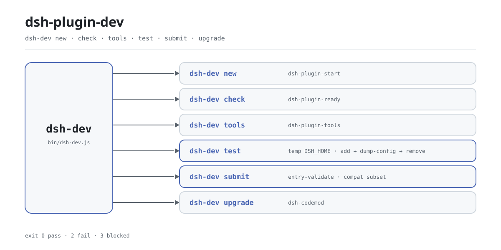

<div align="center">

<picture>
  <source media="(prefers-color-scheme: dark)" srcset="docs/assets/dsh-plugin-dev-flow-dark.svg">
  
</picture>

# dsh-plugin-dev

**एक ही कमांड में DSH प्लगइन का पूरा चक्र — स्कैफ़ोल्ड, प्रीफ़्लाइट, स्मोक टेस्ट और प्रकाशन-पूर्व जाँच।**

DeepSeek Harness प्लगइन लेखकों के लिए पतला डिस्पैचर: छह क्रियाएँ उन टूल्स की ओर जाती हैं जो परिवार पहले से देता है, और इसे इंस्टॉल करने पर सिर्फ़ एक एक्ज़ीक्यूटेबल `dsh-dev` जुड़ता है — कोई कॉन्फ़िग फ़ाइल नहीं, कोई डेमन नहीं, काम खत्म होते ही बंद।

[इंस्टॉल](#तीन-चरणों-में-शुरुआत) · [कॉन्फ़िगरेशन](#कॉन्फ़िगरेशन) · [FAQ](#faq) · [简体中文](README.md) · [English](README.en.md) · [Español](README.es.md) · [Português](README.pt.md) · [हिन्दी](README.hi.md)

[](LICENSE)
[](https://www.npmjs.com/package/dsh-plugin-dev)
[](https://github.com/PerryLink/dsh-plugin-dev/actions/workflows/test.yml)
[](#तीन-चरणों-में-शुरुआत)

[](https://github.com/PerryLink/dsh-plugin-dev/stargazers)
[](https://www.npmjs.com/package/dsh-plugin-dev)
[](https://gitee.com/perrylink/dsh-plugin-dev)

```sh
npm i -g dsh-plugin-dev    # dsh-dev कमांड इंस्टॉल करता है
npx dsh-plugin-dev --help  # या बिना इंस्टॉल किए आज़माएँ
```

</div>

<sub>सामुदायिक टूल, DeepSeek से असंबद्ध। कैनोनिकल रिपॉज़िटरी: <https://github.com/PerryLink/dsh-plugin-dev> (Gitee एक मिरर है)।</sub>

## यह क्या है

`dsh-dev` DSH प्लगइन विकास चक्र का एकल प्रवेश-द्वार है: स्कैफ़ोल्ड, प्रीफ़्लाइट, टूलचेन, अलग-थलग स्मोक टेस्ट, प्रकाशन-पूर्व जाँच और अपग्रेड — छह क्रियाएँ एक ही कमांड में। यह स्वयं इनमें से कुछ भी लगभग नहीं बनाता: `new` काम `dsh-plugin-start` को सौंपता है, `check` काम `dsh-plugin-ready` को, `tools` काम `dsh-plugin-tools` को, और `upgrade` केवल `dsh-codemod` खोजकर उसे कॉल करता है; इस रेपो का असली ऑर्केस्ट्रेशन `test` और `submit` हैं। तीनों उप-टूल सामान्य npm निर्भरताओं के रूप में साथ आते हैं, इसलिए एक ग्लोबल इंस्टॉल से छहों क्रियाएँ मिल जाती हैं।

पैकेज का नाम `dsh-plugin-dev` और कमांड का नाम `dsh-dev` जानबूझकर अलग है: `dsh-primer` पहले से एक `dsh-plugin-dev` एक्ज़ीक्यूटेबल रखता है, और छोटा नाम दोनों को साथ चलने देता है। और चूँकि यह DSH प्लगइन नहीं है — कोई profile माउंट नहीं करता, `cordis.patch.yml` की ज़रूरत नहीं, होस्ट प्रोसेस में नहीं रहता — यह बस एक साधारण Node CLI है जो काम पूरा होते ही बंद हो जाती है।

## तीन चरणों में शुरुआत

1. **इंस्टॉल करें** (Node `>=24.9.0`):

   ```sh
   npm i -g dsh-plugin-dev      # ग्लोबल इंस्टॉल; फिर dsh-dev इस्तेमाल करें
   npx dsh-plugin-dev --version # या बिना इंस्टॉल किए चलाएँ
   ```

   कोई बिल्ड चरण नहीं और कोई profile चुनने की ज़रूरत नहीं — यह होस्ट का कोई एक्सटेंशन रजिस्टर नहीं करता।

2. **स्कैफ़ोल्ड बनाएँ और प्रीफ़्लाइट चलाएँ**:

   ```sh
   dsh-dev new my-plugin --dir ./my-plugin
   cd my-plugin
   dsh-dev check . --strict
   ```

   `new` यानी `dsh-plugin-start` का उपनाम; `--client` ब्राउज़र-आधा हिस्सा भी बनाता है। `check` यानी `dsh-plugin-ready` का उपनाम; `--strict` चेतावनियों को भी विफलता मानता है।

3. **अलग-थलग वातावरण में स्मोक टेस्ट**:

   ```sh
   dsh-dev test . --boot
   ```

   ```text
   dsh-dev test: pass
   target: /path/to/my-plugin
     PASS dsh plugin --profile test add /path/to/my-plugin
     PASS dsh --profile test --dump-config
     PASS dsh --profile test --no-open --port 0
     PASS dsh plugin --profile test remove my-plugin
   not claimed: full UI/boot, C3 certification, security audit
   ```

   `test` एक नई अस्थायी डायरेक्टरी को `DSH_HOME` बनाता है, वहीं इंस्टॉल, कॉन्फ़िग डंप और रिमूव करता है, और अंत में पूरी डायरेक्टरी हटा देता है; `--boot` केवल एक स्टार्टअप URL पकड़ता है, और URL न मिलने का अर्थ `blocked` है, प्लगइन खराब होना नहीं।

   *Observed from `src/dev.js:41-59`; `src/host-test.js:28-118`*

**अनइंस्टॉल**: `npm uninstall -g dsh-plugin-dev`.

## मुख्य क्षमताएँ

छह क्रियाएँ, एक प्रवेश-द्वार। `dsh-dev` केवल आर्ग्युमेंट सामान्य करके आगे भेजता है; असली जाँच उप-टूल्स में रहती है। `--help` और `--version` अंतर्निहित हैं, और अज्ञात कमांड उपयोग-विवरण छापकर 1 लौटाता है।

- **`new` — नया प्लगइन शुरू करें।** `dsh-plugin-start` को सौंपता है: `--dir` लक्ष्य डायरेक्टरी चुनता है, `--client` ब्राउज़र-आधा हिस्सा भी बनाता है।
- **`check` — भेजने से पहले प्रीफ़्लाइट।** `dsh-plugin-ready` को सौंपता है: `--json` मशीन-पठनीय आउटपुट देता है, `--strict` चेतावनियों को विफलता बना देता है।
- **`tools` — टूलचेन प्रबंधन।** `dsh-plugin-tools` को सौंपता है, जिसमें `list`, `doctor`, `install` और `update` उप-कमांड हैं; यह इंस्टॉल करने के बजाय सटीक `npm install -g` कमांड छापता है।
- **`test` — अलग-थलग स्मोक टेस्ट।** अस्थायी `DSH_HOME` में इंस्टॉल, कॉन्फ़िग डंप और रिमूव चलाता है; `--boot` एक `--port 0` प्रोब भी शुरू करके URL पकड़ता है। एग्ज़िट कोड `0` पास, `2` फेल, `3` ब्लॉक्ड।
- **`submit` — प्रकाशन-पूर्व जाँच।** पहले `dsh-plugin-spec` (पुराना नाम `dsh-standards` भी चलता है) का `entry-validate` checkout ढूँढता है, न मिलने पर इस पैकेज में शामिल वही चेकर चलाता है, और अंत में संगत उपसमुच्चय पर आता है। C3 केवल FLOW है: होस्ट साक्ष्य के बिना `not-applicable`, और कोई स्कोर, रैंकिंग या प्रमाणन नहीं।
- **`upgrade` — कोडमॉड को हैंडऑफ़।** `dsh-codemod` खोजता है: मिले तो काम सौंप देता है, न मिले तो इंस्टॉल कमांड छापकर 3 लौटाता है।

```text
dsh-dev new     ──▶ dsh-plugin-start
dsh-dev check   ──▶ dsh-plugin-ready
dsh-dev tools   ──▶ dsh-plugin-tools
dsh-dev test    ──▶ temp DSH_HOME · add → dump-config → remove
dsh-dev submit  ──▶ entry-validate · compat subset
dsh-dev upgrade ──▶ dsh-codemod
```

### कमांड सारांश

| कमांड | उपनाम | मुख्य फ़्लैग | किसे सौंपता है |
|---|---|---|---|
| `dsh-dev new` | `start` | `--dir` `--client` | `dsh-plugin-start` |
| `dsh-dev check` | `ready` | `--json` `--strict` | `dsh-plugin-ready` |
| `dsh-dev tools` | — | `list` `doctor` `install` `update` | `dsh-plugin-tools` |
| `dsh-dev test` | — | `--json` `--boot` | यह रेपो: अस्थायी `DSH_HOME` |
| `dsh-dev submit` | — | `--standards` `--meta` `--host-evidence` `--host-version` `--json` | `entry-validate` या अंतर्निहित चेकर |
| `dsh-dev upgrade` | — | — | `dsh-codemod` |

## कॉन्फ़िगरेशन

`dsh-dev` की कोई कॉन्फ़िग फ़ाइल नहीं और लिखने के लिए कोई ग्लोबल स्थिति नहीं: सभी स्विच कमांड-लाइन फ़्लैग हैं, और उनमें से अधिकतर ज्यों के त्यों आगे वाले टूल को भेजे जाते हैं। यह केवल एक एनवायरनमेंट वेरिएबल पढ़ता है — `DSH_STANDARDS_DIR` — जिसे `submit` चेकर checkout खोजते समय सबसे पहले देखता है।

सबसे आम फ़्लैग:

| फ़्लैग | कमांड | अर्थ |
|---|---|---|
| `--help` / `-h` | सभी | पूरा उपयोग छापता है; बिना किसी आर्ग्युमेंट के यही होता है |
| `--version` / `-v` | सभी | संस्करण छापता है |
| `--dir <dir>` | `new` | लक्ष्य डायरेक्टरी, डिफ़ॉल्ट रूप से प्लगइन नाम |
| `--json` | `check` `test` `submit` | मशीन-पठनीय JSON आउटपुट |
| `--strict` | `check` | चेतावनियाँ भी विफलता (आगे भेजा जाता है) |
| `--boot` | `test` | होस्ट स्टार्टअप URL का एक अतिरिक्त प्रोब |
| `--meta <file>` | `submit` | रेपो मेटाडेटा: `repo`, `topics`, `archived` |

<details>
<summary>पूरी फ़्लैग तालिका (11)</summary>

| फ़्लैग | कमांड | डिफ़ॉल्ट | अर्थ |
|---|---|---|---|
| `--help` / `-h` | सभी | — | उपयोग छापकर 0 से बाहर |
| `--version` / `-v` | सभी | — | संस्करण छापकर 0 से बाहर |
| `--dir <dir>` | `new` | प्लगइन नाम | लक्ष्य डायरेक्टरी |
| `--client` | `new` | बंद | ब्राउज़र-आधा हिस्सा भी बनाएँ (आगे भेजा जाता है) |
| `--json` | `check` `test` `submit` | बंद | मशीन-पठनीय JSON आउटपुट |
| `--strict` | `check` | बंद | चेतावनियाँ विफलता मानें (आगे भेजा जाता है) |
| `--boot` | `test` | बंद | `dsh --profile test --no-open --port 0` भी चलाएँ और URL पकड़ें |
| `--standards <checkout>` | `submit` | स्वतः पहचान | स्पष्ट `dsh-plugin-spec` या `dsh-standards` checkout |
| `--meta <file>` | `submit` | कोई नहीं | रेपो मेटाडेटा (`repo` / `topics` / `archived`) |
| `--host-evidence <file>` | `submit` | कोई नहीं | होस्ट साक्ष्य; `dsh-evidence/1` स्वतः रूपांतरित होता है |
| `--host-version <ver>` | `submit` | कोई नहीं | C4 को भेजा जाने वाला होस्ट संस्करण |

</details>

### एग्ज़िट कोड

| कोड | अर्थ | कहाँ |
|---|---|---|
| `0` | पास, या सामान्य समाप्ति | सभी कमांड |
| `1` | अज्ञात कमांड या गलत आर्ग्युमेंट | `dsh-dev`, `upgrade` का असफल हैंडऑफ़ |
| `2` | जाँच विफल | `test`, `submit` |
| `3` | ब्लॉक्ड या अधूरा | `test` (वातावरण अनुपलब्ध), `submit` (incomplete), `upgrade` (`dsh-codemod` नहीं) |

## FAQ

<details>
<summary>इसका तीन उप-टूल्स से क्या संबंध है?</summary>

यह कार्यान्वयन पैकेजों के ऊपर एक पतला डिस्पैचर है। `dsh-plugin-start`, `dsh-plugin-ready` और `dsh-plugin-tools` इस पैकेज की सामान्य npm निर्भरताएँ हैं और साथ ही इंस्टॉल होती हैं — इन्हें अलग से कभी इंस्टॉल नहीं करना पड़ता। `dsh-dev` केवल आर्ग्युमेंट उनके एंट्री पॉइंट तक पहुँचाता है। उप-टूल्स को सीधे चलाना भी काम करता है; बस एक के बजाय तीन कमांड याद रखने पड़ते हैं।

</details>

<details>
<summary>क्या `test` मेरे असली ~/.dsh को छूता है?</summary>

नहीं। `test` `mkdtemp` से एक अस्थायी डायरेक्टरी बनाकर `DSH_HOME` वहीं सेट करता है, इसलिए इंस्टॉल, कॉन्फ़िग डंप और रिमूव वहीं होते हैं। यदि हल किया गया पथ असली `~/.dsh` के बराबर निकले तो यह चलने से इनकार कर देता है। सफ़ाई `finally` ब्लॉक में है, इसलिए अस्थायी डायरेक्टरी हमेशा हटती है।

</details>

<details>
<summary>`blocked` और `fail` में क्या अंतर है?</summary>

`blocked` का अर्थ है कि वातावरण किसी पूर्व-शर्त को पूरा नहीं करता — लक्ष्य डायरेक्टरी में `package.json` नहीं, या `PATH` पर `dsh` / `pnpm` नहीं — और यह पास नहीं है; एग्ज़िट कोड `3` है। `fail` का अर्थ है कि कोई कमांड वास्तव में विफल हुआ; एग्ज़िट कोड `2` है। दोनों में से कोई हरा नहीं है।

</details>

<details>
<summary>क्या `submit` मेरे प्लगइन को स्कोर या प्रमाणित करता है?</summary>

नहीं। `submit` केवल प्रकाशन-पूर्व संगति जाँचता है: पहले `entry-validate`, फिर अंतर्निहित चेकर, और अंत में संगत उपसमुच्चय; आउटपुट में स्पष्ट रूप से `not a certification` लिखा होता है। C3 केवल FLOW है, होस्ट साक्ष्य न होने पर `not-applicable` दर्ज होता है और कभी विफलता नहीं गिना जाता। कोई स्कोर, रैंकिंग या आधिकारिक समर्थन नहीं।

</details>

<details>
<summary>क्या इसके लिए DSH इंस्टॉल होना ज़रूरी है?</summary>

स्थिर कमांडों के लिए नहीं: `new`, `check`, `tools`, `submit` और `upgrade` सब लोकल चलते हैं और कोई होस्ट शुरू नहीं करते। केवल `test` `PATH` पर मौजूद `dsh` और `pnpm` को कॉल करता है (और `--boot` वास्तव में एक बार `dsh` चलाता है); ये न मिलें तो परिणाम `blocked` है। टूल स्वयं केवल Node `>=24.9.0` माँगता है।

</details>

## ज्ञात सीमाएँ

- **केवल डिस्पैच, कार्यान्वयन नहीं।** स्कैफ़ोल्ड, स्थिर जाँच और टूलचेन तर्क उप-टूल्स में रहते हैं, इसलिए व्यवहार उनके संस्करणों के साथ बदलता है (अभी `dsh-plugin-start@0.2.1`, `dsh-plugin-ready@0.2.2`, `dsh-plugin-tools@0.2.2` पर पिन)।
- **`test` पूरा UI/बूट टेस्ट नहीं है।** यह केवल इंस्टॉल, कॉन्फ़िग डंप और रिमूव की श्रृंखला जाँचता है; `--boot` भी एक ही स्टार्टअप URL पकड़ता है और न मिलने पर `blocked` दर्ज करता है। आउटपुट में शब्दशः `not claimed: full UI/boot` लिखा होता है।
- **`submit` प्रमाणन नहीं देता।** स्टैंडर्ड्स checkout के बिना यह अंतर्निहित चेकर या संगत उपसमुच्चय चलाता है और अधिकतम `pass-with-warnings` तक पहुँचता है; होस्ट साक्ष्य के बिना C3 `not-applicable` है; कोई स्कोर, रैंकिंग या प्रमाणन नहीं।
- **`upgrade` में कोडमॉड शामिल नहीं।** यह केवल `dsh-codemod` खोजकर कॉल करता है; कमांड न मिलने पर इंस्टॉल मार्गदर्शन के साथ 3 लौटाता है।
- **बाहरी कमांड ज़रूरी हैं।** `dsh`, `pnpm` और `dsh-codemod` का `PATH` पर होना आवश्यक है; Windows पर पहचान `where` से और बाकी जगह `which` से होती है।
- **Node संस्करण कड़ी सीमा है।** `>=24.9.0`; इससे पुराने संस्करण पर यह न इंस्टॉल होता है न चलता है।

## विकास

```sh
npm install
npm test                          # node --test, 10 केस
node bin/dsh-dev.js --help        # सोर्स से सीधे चलाएँ
npm pack                          # प्रकाशित tarball बनाएँ
```

संरचना:

| पथ | कार्य |
|---|---|
| `bin/dsh-dev.js` | एक्ज़ीक्यूटेबल एंट्री: `main` कॉल करता है और एग्ज़िट कोड सेट करता है |
| `src/dev.js` | कमांड डिस्पैच, उपयोग पाठ, `test`/`submit` आर्ग्युमेंट पार्सिंग |
| `src/host-test.js` | `test` का अलग-थलग कार्यान्वयन |
| `src/submit.js` | `submit` के लिए चेकर पहचान और संगत उपसमुच्चय |
| `src/evidence.js` | `dsh-evidence/1` का निर्माण और रूपांतरण |
| `src/vendor/` | साथ शामिल `entry-validate` चेकर |
| `test/` | `node --test` केस |
| `scripts/gen-readme-assets.py` | हीरो के दोनों SVG बनाता है (Pillow + CJK फ़ॉन्ट प्रोब) |

चित्र प्रोग्राम द्वारा बनते हैं और दोबारा बनाए जा सकते हैं:

```sh
python scripts/gen-readme-assets.py   # docs/assets/dsh-plugin-dev-flow-{light,dark}.svg लिखता है
```

## परिवार और आभार

यह परियोजना PerryLink की DSH प्लगइन टूलचेन का हिस्सा है (सभी Apache-2.0): `dsh-plugin-start` स्कैफ़ोल्ड संभालता है, `dsh-plugin-ready` प्रीफ़्लाइट, `dsh-plugin-tools` टूलचेन, और `dsh-dev` इन सबको एक प्रवेश-द्वार में समेटता है। अगर यह आपके कुछ कीस्ट्रोक बचाता है, तो **एक स्टार दें** — इससे कोई सुविधा नहीं खुलती, पर अगले प्लगइन लेखक को इसे खोजना आसान हो जाता है।

## लाइसेंस

[LICENSE](LICENSE) (Apache License 2.0) © 2026 dsh-plugin-dev contributors

<p align="center"><sub>Apache-2.0 · सामुदायिक टूल, DeepSeek से असंबद्ध।</sub></p>
