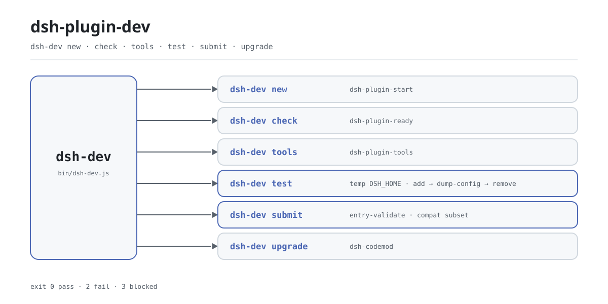

<div align="center">

<picture>
  <source media="(prefers-color-scheme: dark)" srcset="docs/assets/dsh-plugin-dev-flow-dark.svg">
  
</picture>

# dsh-plugin-dev

**一条命令跑完 DSH 插件从新建、自检、冒烟到发布前检查的全流程。**

面向 DeepSeek Harness 插件作者的薄分发器：六个动作指向家族里已经做好的工具，装完只多一个 `dsh-dev` 可执行文件，没有配置文件，不常驻，跑完即退。

[安装](#三步上手) · [配置](#配置) · [FAQ](#faq) · [简体中文](README.md) · [English](README.en.md) · [Español](README.es.md) · [Português](README.pt.md) · [हिन्दी](README.hi.md)

[](LICENSE)
[](https://www.npmjs.com/package/dsh-plugin-dev)
[](https://github.com/PerryLink/dsh-plugin-dev/actions/workflows/test.yml)
[](#三步上手)

[](https://github.com/PerryLink/dsh-plugin-dev/stargazers)
[](https://www.npmjs.com/package/dsh-plugin-dev)
[](https://gitee.com/perrylink/dsh-plugin-dev)

```sh
npm i -g dsh-plugin-dev    # 提供 dsh-dev 命令
npx dsh-plugin-dev --help  # 或者免安装直接试用
```

</div>

<sub>社区工具，与 DeepSeek 官方无关。唯一仓库：<https://github.com/PerryLink/dsh-plugin-dev>（Gitee 为镜像）。</sub>

## 它是什么

`dsh-dev` 是 DSH 插件开发流程的统一入口：新建、自检、工具链、隔离冒烟、发布前检查、升级改造，六个动作共用一条命令。它自己几乎不实现这些能力——`new` 转交 `dsh-plugin-start`，`check` 转交 `dsh-plugin-ready`，`tools` 转交 `dsh-plugin-tools`，`upgrade` 只负责找到并调用 `dsh-codemod`；真正由本仓编排的是 `test` 与 `submit`。三个子工具作为普通 npm 依赖随包安装，所以全局装一次就有全部六个动作。

包名叫 `dsh-plugin-dev`、命令叫 `dsh-dev`，这是刻意的：`dsh-primer` 已经占用了一个 `dsh-plugin-dev` 可执行文件，换个短名才能并存。也正因为它不是 DSH 插件——不挂载 profile、不需要 `cordis.patch.yml`、不在宿主进程里常驻——它只是一条普通的 Node 命令行工具，跑完就退出。

## 三步上手

1. **安装**（Node `>=24.9.0`）：

   ```sh
   npm i -g dsh-plugin-dev      # 全局安装，之后直接用 dsh-dev
   npx dsh-plugin-dev --version # 或者不安装，直接跑
   ```

   没有构建步骤，也不需要挑 profile——它不注册任何宿主扩展。

2. **新建并自检**：

   ```sh
   dsh-dev new my-plugin --dir ./my-plugin
   cd my-plugin
   dsh-dev check . --strict
   ```

   `new` 是 `dsh-plugin-start` 的别名，加 `--client` 会生成带浏览器半的骨架；`check` 是 `dsh-plugin-ready` 的别名，`--strict` 把 warning 也当失败。

3. **在隔离环境里冒烟**：

   ```sh
   dsh-dev test . --boot
   ```

   ```text
   dsh-dev test: pass
   target: /path/to/my-plugin
     PASS dsh plugin --profile test add /path/to/my-plugin
     PASS dsh --profile test --dump-config
     PASS dsh --profile test --no-open --port 0
     PASS dsh plugin --profile test remove my-plugin
   not claimed: full UI/boot, C3 certification, security audit
   ```

   `test` 把 `DSH_HOME` 指向系统临时目录，依次完成安装、导出配置、卸载，最后删掉整个临时目录；`--boot` 只多抓一次启动 URL，抓不到就记 `blocked`，并不等于插件坏了。

   *Observed from `src/dev.js:41-59`; `src/host-test.js:28-118`*

**卸载**：`npm uninstall -g dsh-plugin-dev`。

## 核心能力

六个动作，一个入口。`dsh-dev` 只做参数归一与转交，真正的检查逻辑在各自包里；`--help` 与 `--version` 内置，未知命令返回 1 并打印用法。

- **`new` — 起一个新插件。** 转交 `dsh-plugin-start`：`--dir` 指定生成位置，`--client` 生成带浏览器半的骨架。
- **`check` — 提交前自检。** 转交 `dsh-plugin-ready`：`--json` 输出机读结果，`--strict` 把 warning 升级为失败。
- **`tools` — 工具链管理。** 转交 `dsh-plugin-tools`，支持 `list`、`doctor`、`install`、`update` 四个子命令；它只打印 `npm install -g` 命令，不替你安装。
- **`test` — 隔离环境冒烟。** 在临时 `DSH_HOME` 里跑安装、导出配置、卸载三步；`--boot` 额外起一次 `--port 0` 并抓 URL。退出码 `0` 通过、`2` 失败、`3` 受阻。
- **`submit` — 发布前检查。** 优先使用 `dsh-plugin-spec`（旧名 `dsh-standards` 也认）的 `entry-validate` checkout，找不到就用随包内置的同一份检查器，再退到兼容子集。C3 只做 FLOW 判定：没有宿主证据就是 `not-applicable`，不产出评分、排名或认证。
- **`upgrade` — 升级改造。** 探测 `dsh-codemod`：装了就直接转交，没装就打印安装命令并返回 3。

```text
dsh-dev new     ──▶ dsh-plugin-start
dsh-dev check   ──▶ dsh-plugin-ready
dsh-dev tools   ──▶ dsh-plugin-tools
dsh-dev test    ──▶ temp DSH_HOME · add → dump-config → remove
dsh-dev submit  ──▶ entry-validate · compat subset
dsh-dev upgrade ──▶ dsh-codemod
```

### 命令一览

| 命令 | 别名 | 关键参数 | 交给谁 |
|---|---|---|---|
| `dsh-dev new` | `start` | `--dir` `--client` | `dsh-plugin-start` |
| `dsh-dev check` | `ready` | `--json` `--strict` | `dsh-plugin-ready` |
| `dsh-dev tools` | — | `list` `doctor` `install` `update` | `dsh-plugin-tools` |
| `dsh-dev test` | — | `--json` `--boot` | 本仓：临时 `DSH_HOME` |
| `dsh-dev submit` | — | `--standards` `--meta` `--host-evidence` `--host-version` `--json` | `entry-validate` 或内置检查器 |
| `dsh-dev upgrade` | — | — | `dsh-codemod` |

## 配置

`dsh-dev` 没有配置文件，也没有需要写入的全局状态：所有开关都是命令行参数，大多原样透传给下游工具。唯一会读取的环境变量是 `DSH_STANDARDS_DIR`——`submit` 自动寻找检查器 checkout 时会先看它。

最常用的参数：

| 参数 | 适用命令 | 含义 |
|---|---|---|
| `--help` / `-h` | 全部 | 打印完整用法；不带任何参数等价于此 |
| `--version` / `-v` | 全部 | 打印版本号 |
| `--dir <dir>` | `new` | 生成目录，默认按插件名 |
| `--json` | `check` `test` `submit` | 输出机读 JSON |
| `--strict` | `check` | warning 也按失败计（透传） |
| `--boot` | `test` | 额外探测一次宿主启动 URL |
| `--meta <file>` | `submit` | 仓库元数据：`repo`、`topics`、`archived` |

<details>
<summary>完整参数表（11 个）</summary>

| 参数 | 适用命令 | 默认 | 含义 |
|---|---|---|---|
| `--help` / `-h` | 全部 | — | 打印用法并退出 0 |
| `--version` / `-v` | 全部 | — | 打印版本号并退出 0 |
| `--dir <dir>` | `new` | 按插件名 | 生成目录 |
| `--client` | `new` | 关 | 生成带浏览器半的骨架（透传） |
| `--json` | `check` `test` `submit` | 关 | 机读 JSON 输出 |
| `--strict` | `check` | 关 | warning 视为失败（透传） |
| `--boot` | `test` | 关 | 额外跑 `dsh --profile test --no-open --port 0` 并抓 URL |
| `--standards <checkout>` | `submit` | 自动探测 | 指定 `dsh-plugin-spec` 或 `dsh-standards` checkout |
| `--meta <file>` | `submit` | 无 | 仓库元数据（`repo` / `topics` / `archived`） |
| `--host-evidence <file>` | `submit` | 无 | 宿主证据；`dsh-evidence/1` 会自动转换 |
| `--host-version <ver>` | `submit` | 无 | 透传给 C4 的宿主版本 |

</details>

### 退出码

| 退出码 | 含义 | 出现在 |
|---|---|---|
| `0` | 通过，或正常结束 | 全部命令 |
| `1` | 未知命令或参数错误 | `dsh-dev`、`upgrade` 转交失败 |
| `2` | 检查失败 | `test`、`submit` |
| `3` | 受阻或未完成 | `test`（环境缺失）、`submit`（incomplete）、`upgrade`（缺 `dsh-codemod`） |

## FAQ

<details>
<summary>它和三个子工具是什么关系？</summary>

薄分发器与实现包的关系。`dsh-plugin-start`、`dsh-plugin-ready`、`dsh-plugin-tools` 是 `dsh-plugin-dev` 的普通 npm 依赖，装一次就随包到位，不需要再单独安装；`dsh-dev` 只负责把参数转交给它们的入口。想绕过入口直接调用子工具也可以，只是每条都要单独记命令。

</details>

<details>
<summary>`test` 会碰我机器上真实的 ~/.dsh 吗？</summary>

不会。`test` 用 `mkdtemp` 建一个临时目录作为 `DSH_HOME`，所有安装、导出配置、卸载都在里面完成；如果解析出的路径和真实的 `~/.dsh` 相同，它会直接拒绝执行；收尾放在 `finally` 里，临时目录一定删除。

</details>

<details>
<summary>`blocked` 和 `fail` 有什么区别？</summary>

`blocked` 表示环境不满足前置条件——目标目录没有 `package.json`，或者 `PATH` 上找不到 `dsh` / `pnpm`——它不是通过，退出码为 `3`；`fail` 表示命令真的执行失败了，退出码为 `2`。两者都不算绿。

</details>

<details>
<summary>`submit` 会给我的插件打分或认证吗？</summary>

不会。`submit` 只做发布前的一致性检查：优先跑 `entry-validate`，没有 checkout 就跑内置检查器或兼容子集；输出里明确写着 `not a certification`。C3 是 FLOW-only 判定，没有宿主证据时记 `not-applicable`，不会被当成失败。没有分数、排名或官方背书。

</details>

<details>
<summary>必须装 DSH 才能用吗？</summary>

静态类命令不需要：`new`、`check`、`tools`、`submit`、`upgrade` 都只在本机跑，不启动宿主。只有 `test` 要调用 `PATH` 上的 `dsh` 和 `pnpm`（`--boot` 还要真正拉起一次 `dsh`），缺了就是 `blocked`。工具本身只要求 Node `>=24.9.0`。

</details>

## 已知限制

- **只做转交，不做实现。** 脚手架、静态检查、工具链逻辑都在各自包里，行为随子工具版本变化（当前锁定 `dsh-plugin-start@0.2.1`、`dsh-plugin-ready@0.2.2`、`dsh-plugin-tools@0.2.2`）。
- **`test` 不是完整的 UI/启动测试。** 它只验证安装、导出配置、卸载这条链路；`--boot` 也只抓一次启动 URL，抓不到就记 `blocked`。输出里明确写了 `not claimed: full UI/boot`。
- **`submit` 不认证。** 没有 standards checkout 时使用内置检查器或兼容子集，结论最多到 `pass-with-warnings`；C3 没有宿主证据就是 `not-applicable`；不产出评分、排名或认证。
- **`upgrade` 不内置 codemod。** 它只探测并调用 `dsh-codemod`，缺命令时返回 3 并打印安装方式。
- **依赖外部命令。** `dsh`、`pnpm`、`dsh-codemod` 都必须在 `PATH` 上；Windows 用 `where` 探测，其他平台用 `which`。
- **Node 版本是硬门槛。** `>=24.9.0`，低于此版本装不上也跑不起来。

## 开发

```sh
npm install
npm test                          # node --test，10 个用例
node bin/dsh-dev.js --help        # 直接跑源码
npm pack                          # 打包发布物
```

目录布局：

| 路径 | 作用 |
|---|---|
| `bin/dsh-dev.js` | 可执行入口，只负责调用 `main` 并设置退出码 |
| `src/dev.js` | 命令分发、用法文本、`test`/`submit` 的参数解析 |
| `src/host-test.js` | `test` 的隔离冒烟实现 |
| `src/submit.js` | `submit` 的检查器探测与兼容子集 |
| `src/evidence.js` | `dsh-evidence/1` 证据生成与转换 |
| `src/vendor/` | 随包内置的 `entry-validate` 检查器 |
| `test/` | `node --test` 用例 |
| `scripts/gen-readme-assets.py` | 生成 hero 双版 SVG（Pillow + CJK 字体探测） |

配图由脚本程序化生成，可重复执行：

```sh
python scripts/gen-readme-assets.py   # 写出 docs/assets/dsh-plugin-dev-flow-{light,dark}.svg
```

## 家族与致谢

本项目是 [PerryLink](https://github.com/PerryLink) 维护的 DSH 插件开发工具链成员（全部 Apache-2.0）：`dsh-plugin-start` 负责脚手架，`dsh-plugin-ready` 负责提交前自检，`dsh-plugin-tools` 负责工具链，`dsh-dev` 把它们收成一个入口。如果它帮你少敲了几条命令，**给个 star**——不解锁任何功能，但会让下一个插件作者更容易找到它。

## License

[LICENSE](LICENSE)（Apache License 2.0）© 2026 dsh-plugin-dev contributors

<p align="center"><sub>Apache-2.0 · 社区工具，与 DeepSeek 无关。</sub></p>
