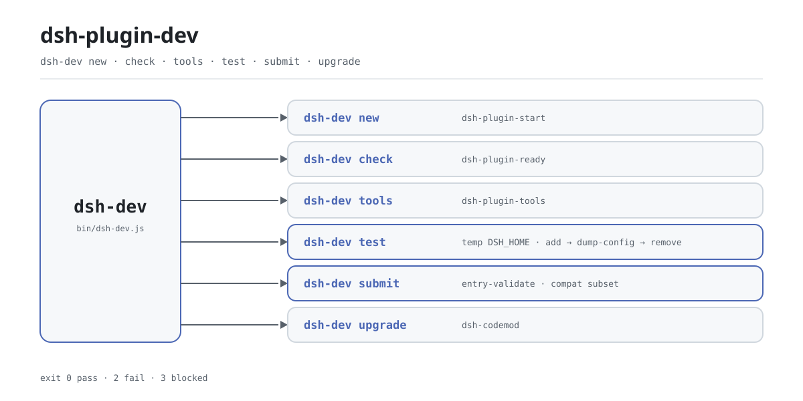

<div align="center">

<picture>
  <source media="(prefers-color-scheme: dark)" srcset="docs/assets/dsh-plugin-dev-flow-dark.svg">
  
</picture>

# dsh-plugin-dev

**Um comando cobre todo o ciclo do plugin DSH: scaffold, preflight, teste de fumaça e checagem antes da publicação.**

Um despachante fino para autores de plugins do DeepSeek Harness: seis ações apontam para ferramentas que a família já publica, e instalá-lo adiciona exatamente um executável, `dsh-dev` — sem arquivo de configuração, sem daemon, sai ao terminar.

[Instalação](#instalação-em-três-passos) · [Configuração](#configuração) · [FAQ](#faq) · [简体中文](README.md) · [English](README.en.md) · [Español](README.es.md) · [Português](README.pt.md) · [हिन्दी](README.hi.md)

[](LICENSE)
[](https://www.npmjs.com/package/dsh-plugin-dev)
[](https://github.com/PerryLink/dsh-plugin-dev/actions/workflows/test.yml)
[](#instalação-em-três-passos)

[](https://github.com/PerryLink/dsh-plugin-dev/stargazers)
[](https://www.npmjs.com/package/dsh-plugin-dev)
[](https://gitee.com/perrylink/dsh-plugin-dev)

```sh
npm i -g dsh-plugin-dev    # instala o comando dsh-dev
npx dsh-plugin-dev --help  # ou experimente sem instalar
```

</div>

<sub>Ferramenta comunitária, sem vínculo com a DeepSeek. Repositório canônico: <https://github.com/PerryLink/dsh-plugin-dev> (o Gitee é um espelho).</sub>

## O que é

`dsh-dev` é o ponto de entrada único do ciclo de desenvolvimento de plugins DSH: scaffold, preflight, cadeia de ferramentas, teste de fumaça isolado, checagem antes da publicação e atualização compartilham um só comando. Ele quase não implementa nada disso: `new` delega ao `dsh-plugin-start`, `check` ao `dsh-plugin-ready`, `tools` ao `dsh-plugin-tools`, e `upgrade` apenas localiza e chama o `dsh-codemod`; o que este repositório realmente orquestra é `test` e `submit`. As três subferramentas chegam como dependências npm comuns, então uma instalação global entrega as seis ações.

O pacote se chama `dsh-plugin-dev` e o comando se chama `dsh-dev` de propósito: o `dsh-primer` já ocupa um executável `dsh-plugin-dev`, e um nome mais curto permite que os dois convivam. E como não é um plugin DSH — não monta profile, não precisa de `cordis.patch.yml` e não vive dentro do processo anfitrião — é apenas uma CLI Node comum, que encerra ao terminar.

## Instalação em três passos

1. **Instale** (Node `>=24.9.0`):

   ```sh
   npm i -g dsh-plugin-dev      # instalação global; depois use dsh-dev
   npx dsh-plugin-dev --version # ou execute sem instalar
   ```

   Não há etapa de build nem profile para escolher: ele não registra nenhuma extensão do anfitrião.

2. **Crie o scaffold e rode o preflight**:

   ```sh
   dsh-dev new my-plugin --dir ./my-plugin
   cd my-plugin
   dsh-dev check . --strict
   ```

   `new` é um alias de `dsh-plugin-start`; `--client` também gera a metade de navegador. `check` é um alias de `dsh-plugin-ready`; `--strict` trata avisos como falhas.

3. **Teste de fumaça em isolamento**:

   ```sh
   dsh-dev test . --boot
   ```

   ```text
   dsh-dev test: pass
   target: /path/to/my-plugin
     PASS dsh plugin --profile test add /path/to/my-plugin
     PASS dsh --profile test --dump-config
     PASS dsh --profile test --no-open --port 0
     PASS dsh plugin --profile test remove my-plugin
   not claimed: full UI/boot, C3 certification, security audit
   ```

   `test` aponta `DSH_HOME` para um diretório temporário novo, executa ali instalação, despejo de configuração e remoção, e depois apaga o diretório inteiro; `--boot` apenas captura uma URL de inicialização, e não obtê-la significa `blocked`, não um plugin quebrado.

   *Observed from `src/dev.js:41-59`; `src/host-test.js:28-118`*

**Desinstalação**: `npm uninstall -g dsh-plugin-dev`.

## Recursos principais

Seis ações, um ponto de entrada. `dsh-dev` apenas normaliza argumentos e os repassa; a checagem real vive nas subferramentas. `--help` e `--version` são embutidos, e um comando desconhecido imprime o uso e retorna 1.

- **`new` — inicia um plugin.** Delega ao `dsh-plugin-start`: `--dir` escolhe o diretório de destino e `--client` gera também a metade de navegador.
- **`check` — preflight antes de enviar.** Delega ao `dsh-plugin-ready`: `--json` produz saída legível por máquina e `--strict` transforma avisos em falhas.
- **`tools` — gestão da cadeia de ferramentas.** Delega ao `dsh-plugin-tools`, com os subcomandos `list`, `doctor`, `install` e `update`; ele imprime o comando exato `npm install -g` em vez de instalar qualquer coisa.
- **`test` — teste de fumaça isolado.** Executa instalação, despejo de configuração e remoção dentro de um `DSH_HOME` temporário; `--boot` ainda inicia uma sonda `--port 0` e captura a URL. Código de saída `0` aprova, `2` falha, `3` fica bloqueado.
- **`submit` — checagem antes da publicação.** Prefere um checkout `entry-validate` do `dsh-plugin-spec` (o nome legado `dsh-standards` também vale); se não houver, usa o mesmo verificador embutido neste pacote e, por último, um subconjunto compatível. C3 é apenas FLOW: sem evidência do anfitrião é `not-applicable`, e não há pontuação, ranking nem certificação.
- **`upgrade` — repasse ao codemod.** Sonda o `dsh-codemod`: se existir, repassa; se faltar, imprime a instalação e retorna 3.

```text
dsh-dev new     ──▶ dsh-plugin-start
dsh-dev check   ──▶ dsh-plugin-ready
dsh-dev tools   ──▶ dsh-plugin-tools
dsh-dev test    ──▶ temp DSH_HOME · add → dump-config → remove
dsh-dev submit  ──▶ entry-validate · compat subset
dsh-dev upgrade ──▶ dsh-codemod
```

### Resumo dos comandos

| Comando | Alias | Opções principais | Delega para |
|---|---|---|---|
| `dsh-dev new` | `start` | `--dir` `--client` | `dsh-plugin-start` |
| `dsh-dev check` | `ready` | `--json` `--strict` | `dsh-plugin-ready` |
| `dsh-dev tools` | — | `list` `doctor` `install` `update` | `dsh-plugin-tools` |
| `dsh-dev test` | — | `--json` `--boot` | este repo: `DSH_HOME` temporário |
| `dsh-dev submit` | — | `--standards` `--meta` `--host-evidence` `--host-version` `--json` | `entry-validate` ou o verificador embutido |
| `dsh-dev upgrade` | — | — | `dsh-codemod` |

## Configuração

`dsh-dev` não tem arquivo de configuração nem estado global para escrever: todas as opções são de linha de comando e a maioria é repassada sem alteração à ferramenta de destino. A única variável de ambiente lida é `DSH_STANDARDS_DIR` — o `submit` a consulta primeiro ao detectar um checkout do verificador.

Opções mais usadas:

| Opção | Comandos | Significado |
|---|---|---|
| `--help` / `-h` | todos | Imprime o uso completo; sem argumentos equivale a isso |
| `--version` / `-v` | todos | Imprime a versão |
| `--dir <dir>` | `new` | Diretório de destino; por padrão, o nome do plugin |
| `--json` | `check` `test` `submit` | Saída JSON legível por máquina |
| `--strict` | `check` | Trata avisos como falhas (repassado) |
| `--boot` | `test` | Também sonda uma URL de inicialização do anfitrião |
| `--meta <file>` | `submit` | Metadados do repo: `repo`, `topics`, `archived` |

<details>
<summary>Tabela completa de opções (11)</summary>

| Opção | Comandos | Padrão | Significado |
|---|---|---|---|
| `--help` / `-h` | todos | — | Imprime o uso e sai com 0 |
| `--version` / `-v` | todos | — | Imprime a versão e sai com 0 |
| `--dir <dir>` | `new` | nome do plugin | Diretório de destino |
| `--client` | `new` | não | Gera também a metade de navegador (repassado) |
| `--json` | `check` `test` `submit` | não | Saída JSON legível por máquina |
| `--strict` | `check` | não | Avisos como falhas (repassado) |
| `--boot` | `test` | não | Também executa `dsh --profile test --no-open --port 0` e captura a URL |
| `--standards <checkout>` | `submit` | autodetecção | Checkout explícito de `dsh-plugin-spec` ou `dsh-standards` |
| `--meta <file>` | `submit` | nenhum | Metadados do repo (`repo` / `topics` / `archived`) |
| `--host-evidence <file>` | `submit` | nenhum | Evidência do anfitrião; `dsh-evidence/1` é convertido automaticamente |
| `--host-version <ver>` | `submit` | nenhum | Versão do anfitrião repassada ao C4 |

</details>

### Códigos de saída

| Código | Significado | Onde |
|---|---|---|
| `0` | Aprovado ou encerramento normal | todos os comandos |
| `1` | Comando desconhecido ou argumentos inválidos | `dsh-dev`, repasse falho do `upgrade` |
| `2` | A checagem falhou | `test`, `submit` |
| `3` | Bloqueado ou incompleto | `test` (ambiente incompleto), `submit` (incomplete), `upgrade` (sem `dsh-codemod`) |

## FAQ

<details>
<summary>Como ele se relaciona com as três subferramentas?</summary>

É um despachante fino sobre os pacotes de implementação. `dsh-plugin-start`, `dsh-plugin-ready` e `dsh-plugin-tools` são dependências npm comuns do `dsh-plugin-dev` e são instaladas junto com ele de uma vez: nunca é preciso instalá-las separadamente. O `dsh-dev` só repassa argumentos para os pontos de entrada delas. Chamar as subferramentas diretamente também funciona; você só precisa lembrar de três comandos em vez de um.

</details>

<details>
<summary>O `test` mexe no meu ~/.dsh real?</summary>

Não. O `test` cria um diretório temporário com `mkdtemp` e aponta o `DSH_HOME` para lá, então instalação, despejo de configuração e remoção acontecem dentro dele. Se o caminho resolvido coincidir com o `~/.dsh` real, ele se recusa a executar. A limpeza fica em um bloco `finally`, então o diretório temporário sempre é apagado.

</details>

<details>
<summary>Qual é a diferença entre `blocked` e `fail`?</summary>

`blocked` significa que o ambiente não cumpre uma precondição — não há `package.json` no diretório de destino, ou não há `dsh` / `pnpm` no `PATH` — e isso não é aprovação; o código de saída é `3`. `fail` significa que um comando realmente falhou; o código de saída é `2`. Nenhum dos dois está verde.

</details>

<details>
<summary>O `submit` pontua ou certifica meu plugin?</summary>

Não. O `submit` só verifica a coerência antes da publicação: prefere o `entry-validate`, depois o verificador embutido e por fim um subconjunto compatível, e a saída diz `not a certification`. C3 é apenas FLOW, registrado como `not-applicable` quando não há evidência do anfitrião, e nunca conta como falha. Não há pontuação, ranking nem endosso oficial.

</details>

<details>
<summary>Preciso ter o DSH instalado para usar?</summary>

Não para os comandos estáticos: `new`, `check`, `tools`, `submit` e `upgrade` rodam localmente e nunca iniciam um anfitrião. Apenas o `test` chama o `dsh` e o `pnpm` do `PATH` (e o `--boot` realmente inicia o `dsh` uma vez); se faltarem, o resultado é `blocked`. A ferramenta em si exige apenas Node `>=24.9.0`.

</details>

## Limitações conhecidas

- **Apenas despacha, não implementa.** Scaffold, checagens estáticas e lógica da cadeia de ferramentas vivem nas subferramentas, então o comportamento segue as versões delas (hoje fixadas em `dsh-plugin-start@0.2.1`, `dsh-plugin-ready@0.2.2`, `dsh-plugin-tools@0.2.2`).
- **O `test` não é um teste completo de UI/inicialização.** Ele valida apenas instalação, despejo de configuração e remoção; o `--boot` ainda captura uma única URL de inicialização e registra `blocked` quando não há. A saída diz literalmente `not claimed: full UI/boot`.
- **O `submit` não certifica.** Sem checkout de padrões ele usa o verificador embutido ou o subconjunto compatível e chega no máximo a `pass-with-warnings`; C3 sem evidência do anfitrião é `not-applicable`; não há pontuação, ranking nem certificação.
- **O `upgrade` não inclui o codemod.** Ele só sonda e chama o `dsh-codemod`; se o comando faltar, retorna 3 com instruções de instalação.
- **Comandos externos são necessários.** `dsh`, `pnpm` e `dsh-codemod` precisam estar no `PATH`; a sondagem usa `where` no Windows e `which` nas demais plataformas.
- **A versão do Node é um piso rígido.** `>=24.9.0`; versões anteriores não instalam nem executam.

## Desenvolvimento

```sh
npm install
npm test                          # node --test, 10 casos
node bin/dsh-dev.js --help        # executa a partir do código-fonte
npm pack                          # gera o tarball publicado
```

Estrutura:

| Caminho | Função |
|---|---|
| `bin/dsh-dev.js` | Entrada executável: chama `main` e define o código de saída |
| `src/dev.js` | Despacho de comandos, texto de uso, parsing de `test`/`submit` |
| `src/host-test.js` | Implementação isolada do `test` |
| `src/submit.js` | Detecção do verificador e subconjunto compatível do `submit` |
| `src/evidence.js` | Geração e conversão de `dsh-evidence/1` |
| `src/vendor/` | O verificador `entry-validate` embutido |
| `test/` | Casos de `node --test` |
| `scripts/gen-readme-assets.py` | Gera os dois SVG do hero (Pillow + sonda de fonte CJK) |

As imagens são geradas por programa e podem ser regeneradas:

```sh
python scripts/gen-readme-assets.py   # escreve docs/assets/dsh-plugin-dev-flow-{light,dark}.svg
```

## Família e créditos

Este projeto faz parte da cadeia de ferramentas de plugins DSH da PerryLink (tudo Apache-2.0): `dsh-plugin-start` cuida do scaffold, `dsh-plugin-ready` do preflight, `dsh-plugin-tools` da cadeia de ferramentas, e `dsh-dev` reúne tudo em um único ponto de entrada. Se ele economiza algumas teclas, **deixe uma estrela** — não desbloqueia nada, mas ajuda o próximo autor de plugins a encontrá-lo.

## Licença

[LICENSE](LICENSE) (Apache License 2.0) © 2026 dsh-plugin-dev contributors

<p align="center"><sub>Apache-2.0 · Ferramenta comunitária, sem vínculo com a DeepSeek.</sub></p>
